# Honeypoint Framework

Framework genérico e extensível para defesa por deception contra reconhecimento multi-estágio.

Desenvolvido como parte da dissertação de mestrado no PPGInf/UFPR. O framework provê a infraestrutura para criar, executar e avaliar **honeypoints** — serviços falsos que simulam vulnerabilidades conhecidas para enganar scanners de reconhecimento e capturar seu comportamento.

A arquitetura é baseada em **drivers**: o core do framework é genérico (tracking de estágios, logging, métricas, launcher), e cada protocolo/CVE é implementado como um driver independente. Novos drivers podem ser adicionados sem modificar o framework.

---

## Arquitetura

```
framework/                 ← Core genérico (não sabe de protocolos)
├── __init__.py
├── base.py                ← HoneyPointDriver: classe base abstrata (contrato do driver)
├── tracker.py             ← SCTracker: tracking de stages + cálculo de SC + logs JSON
└── launcher.py            ← Discovery automático de drivers + execução em threads

drivers/                   ← Implementações específicas de protocolo
├── eternalblue.py         ← Driver SMB: simula CVE-2017-0144 (MS17-010)
├── bluekeep.py            ← Driver RDP: simula CVE-2019-0708
└── README.md              ← Como criar um novo driver
```



A analogia é com IDS como Snort/Suricata: o motor é genérico, a comunidade cria as assinaturas. Aqui, o framework provê o motor de deception, e o usuário implementa drivers para os protocolos e CVEs que deseja simular.

---

## Stage Coverage (SC)

**Stage Coverage** é a métrica central do framework. Ela mede quantas etapas do protocolo de reconhecimento um scanner consegue completar contra o honeypoint:

```
SC = etapas completadas / total de etapas (N)
```

- `SC = 0/N = 0%` → o scanner não interagiu com o protocolo
- `SC = 3/5 = 60%` → o scanner completou 3 de 5 etapas
- `SC = N/N = 100%` → o scanner completou todas as etapas (deception completa)

Cada driver define suas próprias stages ao declarar `DriverMetadata.stages`. O framework calcula o SC automaticamente conforme o driver reporta stages completadas via `tracker.complete_stage(n, ...)`.

---

## Drivers incluídos

Dois drivers de referência são incluídos como prova de conceito:

| Driver | CVE | Protocolo | Porta padrão | Stages | Scanner Metasploit |
|--------|-----|-----------|-------------|--------|--------------------|
| EternalBlue | CVE-2017-0144 | SMB v1 | 445 | 5 | `auxiliary/scanner/smb/smb_ms17_010` |
| BlueKeep | CVE-2019-0708 | RDP | 3389 | 5 | `auxiliary/scanner/rdp/cve_2019_0708_bluekeep` |

### Etapas do EternalBlue (SMB)

| Stage | Nome | O que captura |
|-------|------|--------------|
| E1 | SMB Negotiate | Dialetos suportados, fingerprint do cliente |
| E2 | Session Setup | NativeOS, NativeLanManager — revela a ferramenta |
| E3 | Tree Connect IPC$ | Caminho do share acessado |
| E4 | PeekNamedPipe | Confirmação de verificação de vulnerabilidade |
| E5 | Vuln Check Response | STATUS_INSUFF_SERVER_RESOURCES → scanner reporta "VULNERABLE" |

O sinal comportamental que distingue reconhecimento automatizado de tráfego legítimo é a sequência **E3→E4**: acesso ao IPC$ seguido de PeekNamedPipe *sem* acessar recursos reais. IPC$ sozinho é legítimo em redes Windows.

### Etapas do BlueKeep (RDP)

| Stage | Nome | O que captura |
|-------|------|--------------|
| B1 | X.224 Connection Request | Cookie RDP (hostname do atacante), protocolos suportados |
| B2 | MCS Connect (GCC) | Hostname real, resolução de tela, teclado, timezone |
| B3 | MCS Channel Join | Canais virtuais solicitados |
| B4 | Security Exchange | Chave RSA do cliente |
| B5 | Vuln Check MS_T120 | Tentativa de bind no canal 0x1F (MS_T120) |

---

## Como executar

### Requisitos

```bash
python3 --version  # Python 3.10+
sudo apt install nmap metasploit-framework  # ferramentas de teste
```

### Listar drivers disponíveis

```bash
python3 -m framework.launcher --list
```

Saída esperada:

```
  Honeypoint Framework — Drivers Disponíveis
  Nome                 CVE                Protocolo  Porta    Stages
  ──────────────────────────────────────────────────────────────────
  BlueKeep             CVE-2019-0708      RDP        3389     5
  EternalBlue          CVE-2017-0144      SMB        445      5
```

### Iniciar o framework

```bash
# Todos os drivers (precisa de root para portas < 1024)
sudo python3 -m framework.launcher

# Driver específico
sudo python3 -m framework.launcher --driver eternalblue

# Porta alternativa (sem root)
python3 -m framework.launcher --driver eternalblue --port 4455

# Logging detalhado
sudo python3 -m framework.launcher --verbose
```

Se uma porta já estiver em uso:

```bash
sudo systemctl stop smbd nmbd   # libera porta 445 (Samba)
sudo systemctl stop xrdp        # libera porta 3389 (xrdp)
```

---

## Como testar

> **IMPORTANTE:** `nmap -p 445,3389 <IP>` é um scan de porta simples — verifica apenas se o TCP está aberto. Não envia dados de protocolo, então o honeypoint não consegue progredir além da conexão TCP. Para gerar Stage Coverage, é necessário usar ferramentas que **falam o protocolo**.

### Testar EternalBlue

```bash
# Scanner nmap (SC = 4/5 — para após confirmar "VULNERABLE")
nmap --script smb-vuln-ms17-010 -p 445 127.0.0.1

# Scanner Metasploit (SC = 4/5 — mesmo comportamento)
msfconsole -x 'use auxiliary/scanner/smb/smb_ms17_010; set RHOSTS 127.0.0.1; run'

# Exploit Metasploit (SC = 5/5 — envia payload TRANSACTION2 malformado)
msfconsole -x 'use exploit/windows/smb/ms17_010_eternalblue; set RHOSTS 127.0.0.1; set PAYLOAD generic/shell_reverse_tcp; set LHOST 127.0.0.1; run'
```

| Ferramenta | SC | Comportamento |
|---|---|---|
| `nmap smb-vuln-ms17-010` | 4/5 = 80% | Scanner: para após confirmar "VULNERABLE" em E4 |
| `metasploit smb_ms17_010` (auxiliary) | 4/5 = 80% | Scanner: mesmo comportamento do nmap |
| `metasploit ms17_010_eternalblue` (exploit) | 5/5 = 100% | Exploiter: envia pacotes TRANSACTION2 malformados |

> **Nota:** a distinção 4/5 vs 5/5 permite diferenciar scanners de reconhecimento (que param após confirmar a vulnerabilidade) de ferramentas de exploração real.

### Testar BlueKeep

```bash
# nmap com script RDP (SC = 2/5)
nmap --script rdp-enum-encryption -p 3389 127.0.0.1

# rdpscan (SC = 3/5)
rdpscan 127.0.0.1

# Metasploit scanner BlueKeep (SC = 5/5)
msfconsole -x 'use auxiliary/scanner/rdp/cve_2019_0708_bluekeep; set RHOSTS 127.0.0.1; run'
```

| Ferramenta | SC | Comportamento |
|---|---|---|
| `nmap rdp-enum-encryption` | 2/5 = 40% | Envia X.224 + verifica criptografia |
| `rdpscan` | 3/5 = 60% | Progride até MCS Connect |
| `metasploit cve_2019_0708_bluekeep` | 5/5 = 100% | Completa todas as etapas |

---

## Logs e relatórios

```bash
# Logs em tempo real
tail -f ./logs/eternalblue/honeypoint.log
tail -f ./logs/bluekeep/bluekeep_honeypoint.log

# Eventos JSON estruturados (um por sessão)
ls /var/log/honeypoint/sc_*.json

# Relatório agregado de todas as sessões
python3 -m framework.launcher --report
```

Cada sessão de scanning gera um arquivo JSON em `/var/log/honeypoint/` com timestamps, dados capturados por etapa, ferramenta identificada e SC final.

---

## Como criar um novo driver

Para adicionar suporte a um novo protocolo ou CVE, crie um arquivo em `drivers/`:

```python
# drivers/meu_protocolo.py
from framework import HoneyPointDriver, DriverMetadata, StageDefinition, SCTracker

class MeuProtocoloDriver(HoneyPointDriver):

    def get_metadata(self) -> DriverMetadata:
        return DriverMetadata(
            name="MeuProtocolo",
            cve="CVE-XXXX-XXXX",
            cve_alias="NomePopular",
            protocol="PROTO",
            default_port=9999,
            scanner_module="auxiliary/scanner/proto/cve_xxxx",
            scanner_tool="Metasploit Framework",
            description="Simula servidor PROTO vulnerável",
            stages=[
                StageDefinition(1, "Handshake", "Cliente inicia conexão", "PROTO"),
                StageDefinition(2, "Negotiate", "Negociação de parâmetros", "PROTO"),
                StageDefinition(3, "VulnCheck", "Verificação de vulnerabilidade", "PROTO"),
            ]
        )

    def start(self, port: int, tracker: SCTracker) -> None:
        # Inicia servidor TCP na porta
        # Usa tracker.complete_stage(n, "nome", source_ip=..., data={...})
        # Usa tracker.finalize_session(deception_success=True) ao final
        ...

    def stop(self) -> None:
        ...
```

O launcher descobre o driver automaticamente:

```bash
python3 -m framework.launcher --list    # verifica se aparece
sudo python3 -m framework.launcher --driver meuprotocolo
```

### Como definir as stages

1. Identifique o módulo `auxiliary/scanner/` do Metasploit para o CVE alvo
2. Analise o código-fonte do scanner (Ruby) ou capture o tráfego com Wireshark
3. Decomponha o fluxo em etapas sequenciais — cada troca de mensagem onde o scanner espera uma resposta específica é uma stage
4. Implemente as respostas de protocolo necessárias para que o scanner progrida