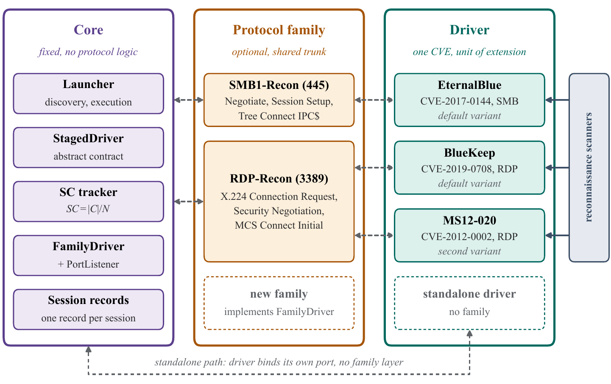

# STAGED — STage-Aware Generic Extensible Decoys

[English](README.md) · **Português (Brasil)**

O STAGED é um framework para construir decoys que conduzem scanners de reconhecimento por todas as stages de uma verificação de vulnerabilidade real. Um decoy responde a cada passo da troca de protocolo do scanner como um host vulnerável responderia; assim, o scanner segue em frente, chega ao seu veredito e deixa registrado tudo o que fez pelo caminho. O framework mede isso com a **Stage Coverage (SC)**: quanto da verificação do scanner o decoy conseguiu sustentar.

Foi desenvolvido como parte de uma dissertação de mestrado no PPGInf/UFPR. O repositório contém:

- **o framework** (`framework/`, `families/`, `drivers/`): só a biblioteca padrão do Python, com três decoys incluídos (EternalBlue, BlueKeep, MS12-020);
- **um baseline Honeyd** (`honeyd/`): o Honeyd V1.6d em um contêiner, com o script SMB de fábrica do próprio Honeyd;
- **o laboratório de comparação** (`honeyd/lab/`, `honeyd/sc_toolkit/`): um ambiente de testes em podman rootless que roda scanners reais contra o STAGED, o Honeyd e um socket inerte, pontua cada execução a partir da sua captura de pacotes e gera as tabelas. As execuções armazenadas ficam em `honeyd/lab/results/`.

## Sumário

1. [Início rápido](#início-rápido)
2. [Estrutura do repositório](#estrutura-do-repositório)
3. [Arquitetura](#arquitetura)
4. [Stage Coverage](#stage-coverage)
5. [Drivers incluídos](#drivers-incluídos)
6. [Como executar o STAGED](#como-executar-o-staged)
7. [Como testar o STAGED com scanners reais](#como-testar-o-staged-com-scanners-reais)
8. [Como executar o Honeyd](#como-executar-o-honeyd)
9. [Como executar STAGED vs Honeyd](#como-executar-staged-vs-honeyd)
10. [Resultados](#resultados)
11. [Como criar um novo driver](#como-criar-um-novo-driver)
12. [Escopo e segurança](#escopo-e-segurança)

## Início rápido

Você precisa de Linux e Python 3.10 ou mais recente. Não há nada para instalar: o `requirements.txt` está vazio de propósito.

```bash
git clone https://github.com/danmvas/staged-decoys.git
cd staged-decoys
python3 -m framework.launcher --list

# o decoy do EternalBlue numa porta não privilegiada (não precisa de root)
STAGED_LOG_DIR=$PWD/logs/sc python3 -m framework.launcher --driver eternalblue --port 14455
```

Em um segundo terminal, no mesmo diretório, conduza o decoy pelas suas cinco stages e leia o resumo da sessão:

```bash
python3 honeyd/sc_toolkit/probe_smb.py --host 127.0.0.1 --port 14455
STAGED_LOG_DIR=$PWD/logs/sc python3 -m framework.launcher --report
```

O `probe_smb.py` é um substituto, escrito à mão, da verificação do MS17-010. Para usar os scanners reais, veja [Como testar o STAGED com scanners reais](#como-testar-o-staged-com-scanners-reais). Pare o decoy com Ctrl+C.

## Estrutura do repositório

```
framework/              core genérico, sem lógica de protocolo
  base.py               StagedDriver, DriverMetadata, StageDefinition: o contrato do driver
  family.py             FamilyDriver + PortListener: vários drivers em uma porta compartilhada
  tracker.py            SCTracker: tracking de stages, SC, um registro JSON por sessão
  launcher.py           descoberta de drivers e o launcher de linha de comando
families/               troncos de protocolo compartilhados, opcionais
  smb.py                SMB1-Recon: Negotiate → Session Setup → Tree Connect IPC$
  rdp.py                RDP-Recon: X.224 Connection Request → Security Negotiation → MCS Connect Initial
drivers/                um módulo fino por CVE
  eternalblue.py        CVE-2017-0144 (MS17-010)
  bluekeep.py           CVE-2019-0708 (BlueKeep)
  ms12_020.py           CVE-2012-0002 (MS12-020)
  _common/              utilitário de logging compartilhado pelos drivers (não é um driver)
main.py                 o launcher, executável a partir de qualquer diretório
honeyd/                 o baseline Honeyd e o laboratório de comparação
  Containerfile, entrypoint.sh, windows.conf.in    a imagem do Honeyd e a sua configuração
  smoke_test.sh         comprova que a imagem do Honeyd responde (cerca de 5 s)
  HONEYD_SETUP.md       como se chegou ao build do Honeyd (o §0 é o caminho verificado)
  RUNBOOK.md            o procedimento de comparação
  lab/                  o laboratório podman: lab.sh, run_all.sh, report.py, FINDINGS.md, results/
  sc_toolkit/           o observador e as ferramentas de execução: sc_observer.py, run_matrix.sh,
                        aggregate_sc.py, probe_smb.py, honeyd_inetd.py, experimental_protocol.md
framework_architecture.pdf, .png    a figura da arquitetura
```

`framework/`, `families/` e `drivers/` têm, cada um, o seu próprio README.

## Arquitetura



A figura também está disponível em [PDF](framework_architecture.pdf).

O STAGED tem duas camadas obrigatórias e uma opcional:

- **O core** (`framework/`) não sabe nada de protocolos. Ele descobre os drivers, acompanha as stages, calcula o SC, grava os registros de sessão e permite que vários drivers compartilhem uma porta (`family.py`).
- **Os drivers** (`drivers/`) são a unidade de extensão: uma CVE cada. Um driver declara as suas stages e responde ao scanner.
- **As famílias** (`families/`) são opcionais. Uma família concentra o tronco de reconhecimento que várias CVEs de um mesmo protocolo compartilham e permite que os drivers dessas CVEs compartilhem uma porta: ela decide, a cada conexão, qual driver assume. Um driver também pode herdar diretamente de `StagedDriver` e ter a sua própria porta (o caminho standalone na figura).

Novas famílias e novos drivers são adicionados sem modificar o core. A analogia é com um IDS como o Snort ou o Suricata, em que um motor genérico executa assinaturas escritas pelos seus usuários: aqui, o core é o motor de deception, as famílias são os "decoders" de protocolo compartilhados por assinaturas relacionadas, e os drivers são as assinaturas.

### Dispatch das famílias

Todos os drivers de uma família registrados na mesma porta compartilham um único listener. A família conduz as stages do tronco uma vez por conexão, guarda essas stages em buffer e resolve a conexão para um driver (uma *variante*) quando aparece o sinal de divergência:

- **SMB1-Recon (445).** O primeiro comando depois do Tree Connect decide. O EternalBlue é, por enquanto, o único membro e a variante default.
- **RDP-Recon (3389).** O BlueKeep e o MS12-020 compartilham a porta. O MS12-020 assume a conexão no segundo Attach User Request; caso contrário, o BlueKeep, a variante default, assume no primeiro Channel Join. Em seguida, a família conduz a sequência de conexão RDP (troca de segurança, licenciamento, capabilities, finalização, primeira atualização de tela) até a sonda do scanner.

Uma conexão que termina antes de poder ser resolvida exercitou apenas o tronco; por isso, ela é registrada sob a família (`SMB1-Recon` ou `RDP-Recon`, com `cve` = `unresolved`), e não sob um driver. O `rdp-enum-encryption` do Nmap e a conexão de fingerprint do scanner de BlueKeep do Metasploit produzem registros assim.

O dispatch exige os dois drivers RDP no mesmo processo do launcher. Com `--driver bluekeep`, uma verificação de MS12-020 é registrada como uma sessão do BlueKeep em 4/5, embora o scanner ainda reporte VULNERABLE. Veja o mecanismo em [families/README.pt-BR.md](families/README.pt-BR.md).

## Stage Coverage

```
SC = stages completadas / N
```

Cada driver declara as suas N stages em `DriverMetadata.stages` e informa o progresso com `tracker.complete_stage(n, ...)`. Todos os drivers incluídos têm N = 5. Três regras valem para todos os drivers:

- **A stage N é a troca que carrega o veredito**: a requisição e a resposta das quais o scanner tira o seu veredito. O que o scanner fizer depois é registrado em `activity_beyond_n` e não conta. O scanner de MS17-010 do Metasploit, por exemplo, continua enviando transações depois do PeekNamedPipe que lhe dá o veredito, enquanto o Nmap para ali; os dois pontuam 5/5.
- **`deception_success` só é verdadeiro com SC = N.** Em 4/5, o scanner ainda não chegou à troca em que se baseia para decidir.
- **SC = N não significa que o scanner disse VULNERABLE.** Significa que o scanner foi conduzido pela troca em que se baseia para decidir; por isso, o veredito é reportado numa coluna própria. Numa execução anterior, o MS12-020 chegou a 5/5 no tráfego, enquanto o scanner dizia SAFE em 29 de 30 execuções.

O SC é medido dos dois lados:

- **SC_int** é o registro do próprio STAGED: um `sc_*.json` por sessão.
- **SC_obs** vem do observador externo, `honeyd/sc_toolkit/sc_observer.py`, que pontua uma captura de pacotes com as mesmas listas de stages, sem consultar o decoy. Uma stage só conta quando a requisição do cliente e a resposta do servidor estão, ambas, no tráfego; assim, um decoy que recebe uma sonda e fica em silêncio pontua 0. É o SC_obs que coloca um decoy de terceiros, como o Honeyd, na mesma escala.

Na execução do laboratório citada, SC_int e SC_obs concordam em todas as sessões.

## Drivers incluídos

| Driver | CVE | Protocolo, porta | Família (variante) | Chave `--driver` | Scanner que o driver foi feito para enganar |
|---|---|---|---|---|---|
| EternalBlue | CVE-2017-0144 (MS17-010) | SMB1, 445 | SMB1-Recon (default) | `eternalblue` | `auxiliary/scanner/smb/smb_ms17_010` |
| BlueKeep | CVE-2019-0708 | RDP, 3389 | RDP-Recon (default) | `bluekeep` | `auxiliary/scanner/rdp/cve_2019_0708_bluekeep` |
| MS12-020 | CVE-2012-0002 | RDP, 3389 | RDP-Recon | `ms12020` | `auxiliary/scanner/rdp/ms12_020_check` |

O laboratório também roda contra eles o `smb-vuln-ms17-010` do Nmap, o `check` do módulo de exploit de MS17-010 do Metasploit, o rdpscan e o `rdp-enum-encryption` do Nmap (veja [Resultados](#resultados)).

### EternalBlue (SMB)

| # | Stage | O que acontece |
|---|---|---|
| 1 | SMB Negotiate | O cliente oferece os seus dialetos; o decoy escolhe NT LM 0.12 (SMB1) |
| 2 | Session Setup | O decoy aceita a sessão como um host Windows 7 SP1 e registra as strings de conta, domínio, sistema operacional nativo e LAN Manager do cliente |
| 3 | Tree Connect IPC$ | Registra o caminho do share |
| 4 | PeekNamedPipe | O primeiro Trans PeekNamedPipe do scanner |
| 5 | Vuln Check Response | O decoy responde a esse PeekNamedPipe com STATUS_INSUFF_SERVER_RESOURCES, que os scanners leem como VULNERABLE. Esta é a troca que carrega o veredito |

As stages 4 e 5 são creditadas juntas; por isso, o SC passa direto de 3/5 para 5/5. O sinal comportamental que distingue reconhecimento automatizado de tráfego comum é a passagem da stage 3 para a 4: acesso ao IPC$ seguido de PeekNamedPipe, sem acessar nenhum recurso real. IPC$ sozinho é normal em redes Windows.

### BlueKeep (RDP)

| # | Stage | O que acontece |
|---|---|---|
| 1 | X.224 Connection Request | Registra o cookie, os protocolos de segurança pedidos e um palpite sobre a ferramenta |
| 2 | Security Negotiation | O Connection Confirm seleciona o Standard RDP Security: sem TLS, sem NLA. É creditada junto com a stage 1 e não tem troca própria |
| 3 | MCS Connect Initial | Registra a versão do RDP do cliente, a resolução, o layout de teclado, o build, o hostname e os canais estáticos |
| 4 | Channel Join | O scanner faz join nos canais virtuais |
| 5 | MS_T120 Probe | Dados no canal MS_T120 depois da sequência de conexão completa. O decoy responde com um MCS Disconnect Provider Ultimatum, como faz um host vulnerável. Esta é a troca que carrega o veredito |

Como a stage 2 vem junto com a stage 1, qualquer cliente que envie um X.224 Connection Request válido pontua pelo menos 2/5 no RDP.

### MS12-020 (RDP)

| # | Stage | O que acontece |
|---|---|---|
| 1–3 | Tronco RDP-Recon | Como no BlueKeep |
| 4 | Second Attach User Request | O scanner pede um segundo ID de usuário MCS; a conexão é resolvida para o MS12-020 aqui |
| 5 | Channel Join Check | O primeiro Channel Join depois do segundo Attach User, aceito com resultado 0. Esta é a troca que carrega o veredito do `ms12_020_check` |

Se esse Channel Join é ou não um bind cross-user fica registrado (`cross_user`), mas não é exigido: o Metasploit tira o initiator de bytes da sua primeira leitura, então ele nunca é um dos usuários anexados.

> **Ressalva.** O `ms12_020_check` lê em offsets fixos daquilo que o seu primeiro `recv` devolver. A família RDP segura o MCS Connect Response por até 100 ms (`CONNECT_RESPONSE_HOLD` em `families/rdp.py`) e o envia no mesmo segmento que a resposta seguinte, para que os offsets do módulo caiam onde ele espera. Isso foi ajustado ao parser do Metasploit e não foi conferido contra um host Windows real. É uma escolha de deception, não fidelidade ao protocolo.

## Como executar o STAGED

### Requisitos

- Linux e Python 3.10 ou mais recente (desenvolvido e testado com o 3.14), apenas a biblioteca padrão.
- Root só para a porta 445. A porta 3389 fica acima do valor padrão de `net.ipv4.ip_unprivileged_port_start` no Linux (1024); por isso, um usuário comum consegue fazer bind nela.
- [podman](https://podman.io), rootless, para a opção com contêiner, os scanners reais e o laboratório.

### O launcher

Execute-o a partir da raiz do repositório. O `python3 main.py …` aceita as mesmas opções e funciona a partir de qualquer diretório.

| Comando | Efeito |
|---|---|
| `python3 -m framework.launcher` | Inicia todos os drivers, cada um na sua porta padrão |
| `python3 -m framework.launcher --driver <key>` | Inicia um driver: `eternalblue`, `bluekeep` ou `ms12020` |
| `python3 -m framework.launcher --driver <key> --port <n>` | Inicia o driver em outra porta. `--port` é ignorado sem `--driver` |
| `python3 -m framework.launcher --list` | Lista os drivers. `--verbose --list` também imprime as chaves deles |
| `python3 -m framework.launcher --report` | Resume os registros de sessão em `$STAGED_LOG_DIR` |
| `python3 -m framework.launcher --verbose` | Saída de depuração da descoberta de drivers |

As mensagens do launcher são em português. O `--list` imprime:

```
======================================================================
  STAGED — Drivers Disponíveis
======================================================================
  Nome                 CVE                Protocolo  Porta    Stages   Família
  ────────────────────────────────────────────────────────────────────────────────
  BlueKeep             CVE-2019-0708      RDP        3389     5        RDP-Recon
  EternalBlue          CVE-2017-0144      SMB        445      5        SMB1-Recon
  MS12020              CVE-2012-0002      RDP        3389     5        RDP-Recon
======================================================================
```

`STAGED_LOG_DIR` define para onde vão os registros de sessão. O padrão é `/var/log/staged`, que um usuário comum não consegue criar; por isso, **defina-o em toda execução sem root** e use o mesmo valor no `--report`.

### Opção 1: um driver, sem root

```bash
STAGED_LOG_DIR=$PWD/logs/sc python3 -m framework.launcher --driver eternalblue --port 14455
STAGED_LOG_DIR=$PWD/logs/sc python3 -m framework.launcher --driver bluekeep     # a 3389 não precisa de root
```

`logs/` está no `.gitignore`. Lembre-se de que o MS12-020 só é diferenciado do BlueKeep quando os dois rodam no mesmo processo (opções 2 e 3).

### Opção 2: todos os drivers nas portas reais, como root

```bash
sudo python3 -m framework.launcher
```

Os registros de sessão vão para `/var/log/staged/`. Se uma porta estiver ocupada, `sudo ss -ltnp 'sport = :445 or sport = :3389'` mostra por quem: normalmente o Samba (`smb`/`nmb` no Fedora, `smbd`/`nmbd` no Debian e no Ubuntu) ou um servidor RDP como o xrdp, o GNOME Remote Desktop ou o KRdp do KDE.

Uma execução como root deixa em `./logs/` arquivos que pertencem ao root. Uma execução posterior sem root, no mesmo diretório, descarta então esses drivers com um aviso (`Erro ao importar drivers.… Permission denied`); por isso, use outro diretório ou `sudo chown -R "$USER" logs`.

Sem root, o launcher com todos os drivers ainda atende RDP na 3389, mas a thread do EternalBlue morre na 445 com um traceback, enquanto o processo continua rodando.

### Opção 3: todos os drivers, sem root, em um contêiner

O contêiner faz bind da 445 e da 3389 no seu próprio network namespace, e o podman as publica em portas de loopback do host. Execute a partir da raiz do repositório:

```bash
mkdir -p "$HOME/staged-run/logs" "$HOME/staged-run/sc"
podman run -d --rm --name staged --security-opt label=disable \
  -v "$PWD":/app:ro -v "$HOME/staged-run/logs":/app/logs -v "$HOME/staged-run/sc":/logs \
  -w /app -e STAGED_LOG_DIR=/logs -e PYTHONUNBUFFERED=1 \
  -p 127.0.0.1:14455:445 -p 127.0.0.1:13389:3389 \
  docker.io/library/python:3.14-slim python3 -m framework.launcher
podman logs -f staged     # pronto quando aparecer "Variantes ativas na porta 3389: ['BlueKeep', 'MS12020']"
```

- A montagem gravável em `/app/logs` é obrigatória: o repositório é montado como somente leitura, e cada driver abre os seus arquivos de log ao ser importado.
- `--security-opt label=disable` permite que o contêiner leia o repositório em hosts com SELinux, como o Fedora, sem alterar os rótulos dele.
- Publicar em `127.0.0.1` mantém o decoy fora da sua rede. Remova o endereço para expô-lo.
- Com o encaminhamento de portas rootless, as sessões são registradas com o endereço IP principal do seu host como origem, e não com 127.0.0.1.

Pare-o com `podman stop staged` e resuma as sessões dele com `STAGED_LOG_DIR=$HOME/staged-run/sc python3 -m framework.launcher --report`.

### O que uma execução produz

- **Console:** o progresso stage a stage, a resolução da variante e um quadro-resumo por sessão. A maioria das linhas aparece duas vezes, em dois formatos.
- **Registros de sessão (SC_int):** `$STAGED_LOG_DIR/sc_<name>_<UTC timestamp>_<random>.json`, em que `<name>` é o driver, ou a família no caso de uma sessão não resolvida. Há um arquivo por conexão que completou pelo menos uma stage; assim, um port scan simples não grava nada, e um único scan pode gravar vários arquivos. Cada arquivo contém o driver e a CVE, o número total de stages e o de stages completadas, `sc_score`, `deception_success`, os horários de início e de fim, o IP e a porta de origem, cada evento de stage com os dados capturados nele, e `activity_beyond_n`. `scanner_tool` e `scanner_module` indicam o scanner para o qual o driver foi feito, não a ferramenta que se conectou.
- **Logs dos drivers,** relativos ao diretório de trabalho: `logs/eternalblue/{staged.log,events.jsonl}`, `logs/bluekeep/{bluekeep_staged.log,bluekeep_events.jsonl}` e `logs/ms12_020/{staged.log,events.jsonl}`. Os drivers os criam ao serem importados, até mesmo com `--list`. Eles guardam as linhas e os eventos estruturados dos próprios drivers; o progresso das stages fica no console e nos registros de sessão.
- **`--report`** lê `$STAGED_LOG_DIR/sc_*.json` e imprime, por driver ou família, cada sessão (horário, SC, ✅ ou ❌ para `deception_success`, IP de origem) e o SC médio e o máximo.

Ctrl+C ou SIGTERM encerram o launcher. As sessões ainda abertas nesse momento não são gravadas.

### Solução de problemas

| Sintoma | Causa |
|---|---|
| Um traceback de thread terminando em `PermissionError: … '/var/log/staged'`, e nada escutando | Execução sem root e sem `STAGED_LOG_DIR` |
| `PermissionError` ou `Address already in use` no bind, e o launcher continua rodando | Porta 445 sem root, ou uma porta já em uso. Um driver que falha não derruba os outros; confira com `ss -ltn` |
| `Driver 'ms12_020' não encontrado` | A chave é `ms12020` |
| `--port` não tem efeito | Ele só vale junto com `--driver` |
| `No module named 'framework'` | `-m framework.launcher` só funciona a partir da raiz do repositório; em outros diretórios, use `python3 /path/to/main.py` |
| Um driver não aparece no `--list`, com `Erro ao importar … Permission denied` | Arquivos do root em `./logs/`, deixados por uma execução anterior com `sudo` |

## Como testar o STAGED com scanners reais

Os scanners ficam em uma única imagem, `localhost/sc-scanner`: Metasploit 6.5.9-dev, Nmap 7.99, rdpscan (commit 09db271) e tcpdump. O `./honeyd/lab/lab.sh up` faz o build dela quando ela não existe. Para fazer o build à mão (cerca de 2,5 GB, requer acesso à internet):

```bash
podman build --cap-add NET_RAW -t localhost/sc-scanner -f honeyd/lab/scanner.Containerfile honeyd/lab
```

Com o contêiner da opção 3 rodando (SMB na 14455, RDP na 13389):

```bash
SCAN="podman run --rm --network host --cap-add NET_RAW localhost/sc-scanner"

$SCAN msfconsole -q -x 'use auxiliary/scanner/smb/smb_ms17_010; set RHOSTS 127.0.0.1; set RPORT 14455; run; exit'
$SCAN msfconsole -q -x 'use exploit/windows/smb/ms17_010_eternalblue; set RHOSTS 127.0.0.1; set RPORT 14455; set PAYLOAD generic/shell_reverse_tcp; set LHOST 127.0.0.1; check; exit'
$SCAN nmap --unprivileged -Pn -p14455 --script smb-vuln-ms17-010 --script-args smbport=14455 127.0.0.1

$SCAN msfconsole -q -x 'use auxiliary/scanner/rdp/cve_2019_0708_bluekeep; set RHOSTS 127.0.0.1; set RPORT 13389; run; exit'
$SCAN rdpscan -p 13389 127.0.0.1
$SCAN nmap --unprivileged -Pn -p13389 --script +rdp-enum-encryption 127.0.0.1

$SCAN msfconsole -q -x 'use auxiliary/scanner/rdp/ms12_020_check; set RHOSTS 127.0.0.1; set RPORT 13389; run; exit'
```

| Ferramenta | Linha do veredito | Registros de sessão |
|---|---|---|
| msf `smb_ms17_010` | `Host is likely VULNERABLE to MS17-010!` | EternalBlue 5/5, com atividade além de N |
| msf `ms17_010_eternalblue` `check` | `The target is vulnerable.` | EternalBlue 5/5, com atividade além de N |
| nmap `smb-vuln-ms17-010` | `State: VULNERABLE` | EternalBlue 5/5 |
| msf `cve_2019_0708_bluekeep` | `The target is vulnerable. The target attempted cleanup of the incorrectly-bound MS_T120 channel.` | BlueKeep 5/5, mais RDP-Recon 2/5 pela sua conexão de fingerprint |
| rdpscan | `VULNERABLE - got appid` | BlueKeep 5/5 |
| nmap `rdp-enum-encryption` | uma tabela de camadas de segurança, sem veredito de vulnerabilidade | 9 × RDP-Recon, no máximo 3/5 |
| msf `ms12_020_check` | `The target is vulnerable. Response confirmed vulnerability presence` | MS12020 5/5 |

- `--cap-add NET_RAW` é obrigatório no podman rootless: o `msfconsole` (Ruby) e o `nmap` têm file capabilities e, sem essa opção, falham com `Operation not permitted`. Com `--network host`, o Nmap também precisa de `--unprivileged`.
- Em portas não padrão, o Nmap pula os dois scripts silenciosamente, a menos que receba instrução em contrário: o `smb-vuln-ms17-010` precisa de `--script-args smbport=<port>`, e o `rdp-enum-encryption` precisa do `+` na frente do nome. Contra as portas reais 445 e 3389 (opção 2), omita `RPORT`, `smbport` e o `+`.
- O `rdp-enum-encryption` é uma sonda de reconhecimento, não uma verificação de BlueKeep. Ele negocia e enumera camadas de segurança, mas nunca anexa um usuário nem faz join em um canal; por isso, fica em 3/5 por construção.
- Use o módulo de exploit do EternalBlue somente com `check`. Nunca o execute com `run` ou `exploit`.
- Sem a imagem dos scanners, `python3 honeyd/sc_toolkit/probe_smb.py --host 127.0.0.1 --port 14455 [--stop-at N]` percorre as stages SMB à mão.

## Como executar o Honeyd

O Honeyd é o baseline tirado dos trabalhos relacionados (o alvo T2 no laboratório). A imagem compila o Honeyd V1.6d a partir do DataSoft/Honeyd, no commit a0f3d64, e configura um host virtual que se apresenta como Windows 7:

- A porta 445 roda o único script SMB que vem com o Honeyd, o `smb-autofail`, portado para Python 3. Ele responde ao Negotiate e ao Session Setup e nega o Tree Connect com STATUS_ACCESS_DENIED.
- O Honeyd não traz nenhum script RDP; por isso, a 3389 é resetada, como todas as outras portas.

Tudo o que vem a seguir roda rootless, a partir da raiz do repositório.

**1. Faça o build da imagem** uma vez (requer acesso à internet). O `smoke_test.sh` e o `lab.sh` também fazem o build quando ela não existe.

```bash
podman build -t localhost/honeyd:a0f3d64 -f honeyd/Containerfile honeyd/
```

**2. Rode o smoke test** (cerca de 5 s). Ele cria a rede podman isolada `honeylab` (10.0.0.0/24, sem rota para fora), roda o Honeyd em 10.0.0.2 emulando o 10.0.0.50 e o sonda a partir do 10.0.0.9, com uma captura real do tcpdump.

```bash
./honeyd/smoke_test.sh                  # saída em honeyd/smoke_out/ (ignorado pelo git)
OUT=/some/dir ./honeyd/smoke_test.sh    # ou em outro lugar
```

Uma execução bem-sucedida mostra `ttl=128` (a personalidade Windows), `445 port … succeeded!`, `3389 … Connection refused` e `SC_obs = 2/5` (SMB Negotiate, Session Setup). Uma sessão extra com `SC_obs = 0/5` é a verificação da porta. O script não faz nenhuma asserção; por isso, procure essas linhas em vez de olhar o código de saída. Não o rode com o laboratório no ar: os dois usam a `honeylab` e os mesmos endereços.

**3. Verifique a configuração** sem nenhuma rede:

```bash
podman run --rm --network none -e HONEYD_IFACE=lo localhost/honeyd:a0f3d64 --verify-config
```

**4. Rode-o você mesmo** na mesma rede, com o laboratório desligado:

```bash
podman network exists honeylab || podman network create --internal --disable-dns --subnet 10.0.0.0/24 honeylab
podman run -d --name honeyd --network honeylab --ip 10.0.0.2 --cap-add NET_RAW --cap-add NET_ADMIN \
  -e HONEYD_IFACE=eth0 -e HONEYD_IP=10.0.0.50 -e HONEYD_MAC=00:1b:21:3a:4f:50 \
  localhost/honeyd:a0f3d64
podman logs -f honeyd     # pronto quando aparecer "Demoting process privileges to uid 65534"

# um cliente na mesma rede
podman run --rm -it --network honeylab --ip 10.0.0.9 --cap-add NET_RAW --cap-add NET_ADMIN \
  --entrypoint bash localhost/honeyd:a0f3d64
#   dentro dele: ethtool -K eth0 tx off; ping -c1 10.0.0.50; nc -vz 10.0.0.50 445

podman cp honeyd:/var/log/honeyd/. ./honeyd-logs/    # os logs do próprio Honeyd
podman rm -f honeyd
```

| Variável | Padrão | Significado |
|---|---|---|
| `HONEYD_IFACE` | `eth0` | A interface em que o Honeyd escuta; ela precisa existir onde o Honeyd roda |
| `HONEYD_IP` | `10.0.0.50` | O endereço do host emulado |
| `HONEYD_MAC` | `00:1b:21:3a:4f:50` | O MAC do host emulado |

Os argumentos depois do nome da imagem vão para o próprio `honeyd`. O template da configuração é o `honeyd/windows.conf.in`.

- **Checksum offload.** Em uma rede veth, bridge ou tap, o remetente deixa os checksums TCP a cargo de uma placa de rede que não existe, e o Honeyd descarta todo SYN como corrompido: o ping continua funcionando, mas toda porta TCP dá timeout e o SC_obs fica em 0/5. Desligue o offload no cliente (`ethtool -K eth0 tx off`), como fazem o smoke test e o laboratório. Em um cabo físico, isso não é necessário.
- Os nomes de contêiner `t2-honeyd` (o laboratório) e `honeyd-t2` (o smoke test) já estão em uso.

**5. Em uma placa de rede real,** o Honeyd precisa de root, porque envia frames brutos: veja o §0 de [honeyd/HONEYD_SETUP.md](honeyd/HONEYD_SETUP.md) (em inglês). O podman rootful tem o seu próprio armazenamento de imagens; por isso, faça o build da imagem de novo com `sudo` ou copie-a com `podman save localhost/honeyd:a0f3d64 | sudo podman load`.

Os §§1–9 do `HONEYD_SETUP.md` e a parte "Build, install and route" do §1 do `RUNBOOK.md` são anteriores ao contêiner e estão obsoletos.

## Como executar STAGED vs Honeyd

O laboratório de comparação roda scanners reais contra cada alvo, R vezes por ferramenta, em uma única máquina, rootless:

| Alvo | O que é | Endereço |
|---|---|---|
| T1 | STAGED: este repositório, montado como somente leitura, com todos os drivers | 10.0.0.40 |
| T2 | Honeyd, como acima | 10.0.0.50 (contêiner em 10.0.0.2) |
| T3 | Um host Windows real sem patch: o topo da escala | não disponível neste laboratório |
| T4 | Um host Windows real com patch: a referência negativa | não disponível neste laboratório |
| T5 | Um socket inerte que aceita conexões na 445 e na 3389 e nunca responde: o piso | 10.0.0.70 |

O contêiner dos scanners fica em 10.0.0.9. A rede podman `honeylab` é interna, sem DNS, e o `run_all.sh` se recusa a começar se o scanner conseguir alcançar a internet.

| Ataque | Porta | Ferramentas |
|---|---|---|
| `eternalblue` | 445 | msf `smb_ms17_010`; msf `ms17_010_eternalblue` `check`; nmap `smb-vuln-ms17-010` |
| `bluekeep` | 3389 | msf `cve_2019_0708_bluekeep`; rdpscan; nmap `rdp-enum-encryption` |
| `ms12_020` | 3389 | msf `ms12_020_check` |

Antes de cada execução, o decoy é reiniciado com os logs apagados, e o tráfego do scanner é capturado. Para cada execução, o laboratório guarda o pcap, a pontuação do observador (SC_obs), a saída da ferramenta, o log do decoy e o custo do seu contêiner e, para o T1, os registros de sessão (SC_int). As células rodam em ordem aleatória.

### Requisitos

- Linux com podman rootless e cgroup v2 (as colunas de custo leem o `memory.peak` e o `cpu.stat` dos contêineres), e `python3` no host.
- Acesso à internet na primeira vez, para fazer o build de `localhost/honeyd:a0f3d64` e de `localhost/sc-scanner` (cerca de 2,5 GB). O `lab.sh up` faz o build da que estiver faltando.
- Sem root.

### Execução rápida (R = 1, cerca de 5 minutos)

```bash
OUT=$PWD/honeyd/lab/results/try R=1 ./honeyd/lab/run_all.sh
python3 honeyd/lab/report.py honeyd/lab/results/try > honeyd/lab/results/try/REPORT.md
./honeyd/lab/lab.sh down
```

A tabela de cada ataque é impressa à medida que a execução avança. Espere o STAGED em 5/5 com todas as ferramentas, exceto o nmap `rdp-enum-encryption` (3/5); o Honeyd em 2/5, 2/5 e 1/5 no SMB e em 0/5 no RDP; e o socket inerte em 0/5 em tudo. O `REPORT.md` acrescenta os vereditos das ferramentas, SC_int contra SC_obs e o custo por execução.

### Execução completa (R = 30, cerca de 90 minutos)

```bash
OUT=$PWD/honeyd/lab/results/<new-run> ./honeyd/lab/run_all.sh
```

Defina sempre o `OUT`. O padrão é `honeyd/lab/results/main`, a execução original armazenada, cujos arquivos seriam sobrescritos.

| Variável | Padrão | Significado |
|---|---|---|
| `R` | `30` | Repetições por alvo e ferramenta |
| `OUT` | `honeyd/lab/results/main` | Para onde vão os arquivos da execução: um caminho absoluto dentro de `$LAB_RESULTS`. O contêiner dos scanners só monta esse diretório; por isso, uma execução com `OUT` fora dele não produz resultados |
| `ATTACKS` | `eternalblue bluekeep ms12_020` | Quais ataques rodar |
| `LAB_RESULTS` | `honeyd/lab/results` | O diretório de trabalho do laboratório: o estado dos contêineres e o `versions.txt` |
| `T1_SRC` | o repositório | A árvore de código que o T1 roda |

O `run_all.sh` roda `lab.sh up` (imagens, rede, contêineres), `lab.sh versions` (registra a versão de cada ferramenta em `versions.txt`) e `lab.sh safety`; depois, para cada ataque, o `run_matrix.sh` e uma tabela do `aggregate_sc.py`. Cada execução deixa `<attack>_<target>_<tool>_r<i>.{pcap,json,log,decoy.log,cost.json}` em `$OUT`, além de `.sc_int/` e `.t1_logs/` para o STAGED; cada ataque deixa `matrix_<attack>.out` e `table_<attack>.txt`.

### Relatórios

```bash
python3 honeyd/lab/report.py honeyd/lab/results/<run> > honeyd/lab/results/<run>/REPORT.md
python3 honeyd/lab/report.py --rescore honeyd/lab/results/<run>    # repontua os pcaps armazenados com as regras de stage atuais
```

Para cada ataque, o `report.py` dá o SC_obs por célula (cada execução pontuada pela sua sessão TCP mais profunda), o veredito da própria ferramenta, as stages alcançadas, SC_int contra SC_obs pareados pela porta de origem do cliente, e a mediana do custo do contêiner. Ele regenera exatamente os relatórios armazenados.

### Outras ferramentas do laboratório

| Comando | Finalidade |
|---|---|
| `./honeyd/lab/lab.sh up`, `down`, `status` | Inicia, remove ou lista os contêineres do laboratório (os resultados são mantidos) |
| `./honeyd/lab/lab.sh versions`, `safety` | Registra as versões das ferramentas; comprova que não há rota para fora do host |
| `./honeyd/lab/lab.sh restart <target>` | Reinicia um decoy (`STAGED`, `Honeyd` ou `Inert`) com os logs apagados |
| `./honeyd/lab/lab.sh exec <cmd…>` | Roda um comando no contêiner dos scanners |
| `./honeyd/lab/checks.sh` | Ping, teste de porta e sonda SMB de cada decoy, pontuados a partir de uma captura real (com o laboratório no ar) |
| `./honeyd/lab/idle_cost.sh` | O custo de inicialização de cada decoy, sem nenhum scan (R = 10) |
| `./honeyd/lab/diag_bluekeep_verbose.sh` | Vereditos detalhados do BlueKeep: sem isso, o scanner do Metasploit só imprime os VULNERABLE |
| `./honeyd/lab/whatif/run_whatif.sh` | Histórico: as primeiras correções de RDP, como um patch sobre o código original. O patch se aplica ao `d29f66e`, não ao código atual, que já contém as correções |

Por padrão, esses scripts gravam em `honeyd/lab/results/`, onde ficam as execuções armazenadas, sob controle de versão.

Para rodar uma única célula à mão, com o laboratório no ar:

```bash
./honeyd/lab/lab.sh up
cd honeyd/sc_toolkit
EXEC="../lab/lab.sh exec" RESTART="../lab/lab.sh restart" COLLECT="../lab/lab.sh collect" \
  ONLY="STAGED" IFACE=eth0 TCPDUMP_OPTS="-Z root" R=1 OUT=../lab/results/single ./run_matrix.sh ms12_020
python3 sc_observer.py --pcap ../lab/results/single/ms12_020_STAGED_msf_ms12_020_r1.pcap --attack ms12_020
```

O procedimento, o raciocínio por trás das regras de stage e todos os achados estão em [honeyd/RUNBOOK.md](honeyd/RUNBOOK.md) (o §8 trata deste laboratório), [honeyd/lab/FINDINGS.md](honeyd/lab/FINDINGS.md) e [honeyd/sc_toolkit/experimental_protocol.md](honeyd/sc_toolkit/experimental_protocol.md), todos em inglês.

## Resultados

Os números a citar vêm de `honeyd/lab/results/decided/`: R = 30, 630 execuções, commit `54ab944` do framework. Todas as células foram determinísticas, com o mesmo valor nas 30 execuções. Cada célula mostra o SC_obs por execução (a sua sessão mais profunda) e, em seguida, o veredito da ferramenta ou o que a interrompeu.

| Ataque | Ferramenta | T1 STAGED | T2 Honeyd | T5 inerte |
|---|---|---|---|---|
| EternalBlue | msf `smb_ms17_010` | 5/5, VULNERABLE ×30 | 2/5, tree connect negado | 0/5 |
| | msf `ms17_010_eternalblue` `check` | 5/5, VULNERABLE ×30 | 2/5, desconhecido | 0/5 |
| | nmap `smb-vuln-ms17-010` | 5/5, VULNERABLE ×30 | 1/5, sem resultado | 0/5 |
| BlueKeep | msf `cve_2019_0708_bluekeep` | 5/5, VULNERABLE ×30 | 0/5, porta resetada | 0/5 |
| | rdpscan | 5/5, VULNERABLE ×30 | 0/5, porta resetada | 0/5 |
| | nmap `rdp-enum-encryption` | 3/5, enumerou (sem veredito) | 0/5, porta resetada | 0/5 |
| MS12-020 | msf `ms12_020_check` | 5/5, VULNERABLE ×30 | 0/5, porta resetada | 0/5 |

- **SC_int = SC_obs** em todas as sessões comparadas, e nenhum registro de sessão foi perdido.
- **Custo** por execução (mediana dos contadores de cgroup do contêiner, com a inicialização incluída): STAGED cerca de 17,8 MiB e 225–249 ms de CPU, Honeyd 12–14,5 MiB e 51–61 ms, o socket inerte 5,7 MiB e cerca de 23 ms. Sem nenhum scan (`idle_cost.sh`), os valores são 17,8 MiB e 235 ms, 12,0 MiB e 47 ms, e 5,6 MiB e 25 ms: um scan não acrescenta nada mensurável ao STAGED.
- **O Honeyd** só vai até onde o seu script de fábrica vai: o tree connect negado. Contra o Nmap, ele fica com uma stage a menos: o Nmap pede extended security no seu Negotiate, o script responde sem ela, e o Nmap então não envia o Session Setup.

Limitações:

- **O T3 e o T4 não foram executados.** Não havia hypervisor nem imagem do Windows; por isso, o topo da escala não está ancorado, e todo VULNERABLE acima é o veredito de um scanner sobre um decoy.
- **As regras de stage foram fixadas depois de os dados serem vistos.** Elas são aplicadas de modo uniforme a todos os ataques, alvos e execuções, inclusive às execuções mais antigas, e os baselines não mudam com elas.
- **O veredito do MS12-020 depende do agrupamento de respostas** explicitado em [MS12-020](#ms12-020-rdp).

As execuções anteriores são mantidas como registro: `results/main` (o código original, `d29f66e`) e `results/fixed` (depois das correções de RDP, `fd136d2`), cada uma com um `REPORT-rescored.md` sob as regras atuais. As mudanças no código desde o `54ab944` só mexem em rótulos e na flag `deception_success`, e não alteram nenhum número acima.

> **IDs de commit antigos.** O `FINDINGS.md`, o `RUNBOOK.md` e os arquivos `versions.txt` armazenados citam IDs de commit de antes da reescrita do histórico do repositório. As árvores de arquivos não mudaram: `0564e0d` agora é `d29f66e`, `b02681d` é `fd136d2`, e `6e183c4` é `54ab944`. Os registros armazenados também usam nomes antigos: `XXX` como nome do alvo STAGED e "Exploit PDU" para a stage 5 do BlueKeep.

## Como criar um novo driver

1. Encontre um scanner de reconhecimento real para a CVE: um módulo `auxiliary/scanner/` do Metasploit ou equivalente. Ele não pode ser um módulo de exploit, nem mesmo em modo `check`, nem um script categorizado como intrusive ou dos.
2. Leia o código-fonte do scanner ou capture o seu tráfego, e divida a troca em stages. Cada mensagem depois da qual o scanner espera uma resposta específica é uma stage, e a lista termina na troca da qual o scanner tira o veredito.
3. Escreva `drivers/<name>.py`. Herde diretamente de `StagedDriver` para ter uma porta própria, ou de uma base de família (`smb.SMBFamilyDriver`, `rdp.RDPFamilyDriver`) para compartilhar um tronco de protocolo e uma porta com outros drivers.
4. Rode `python3 -m framework.launcher --list`: os drivers são descobertos automaticamente, e a chave do `--driver` é o nome nos metadados, em minúsculas.

Um driver standalone tem esta forma:

```python
# drivers/my_protocol.py
from framework import StagedDriver, DriverMetadata, StageDefinition, SCTracker


class MyProtocolDriver(StagedDriver):

    def get_metadata(self) -> DriverMetadata:
        return DriverMetadata(
            name="MyProtocol",                 # chave do --driver: myprotocol
            cve="CVE-XXXX-XXXX",
            cve_alias="PopularName",
            protocol="PROTO",
            default_port=9999,
            scanner_module="auxiliary/scanner/proto/cve_xxxx",
            scanner_tool="Metasploit Framework",
            description="Simulates a vulnerable PROTO server",
            stages=[
                StageDefinition(1, "Handshake", "The client opens a session", "PROTO"),
                StageDefinition(2, "Negotiate", "Parameter negotiation", "PROTO"),
                StageDefinition(3, "Vuln Check", "The exchange the scanner takes its verdict from", "PROTO"),
            ],
        )

    def start(self, port: int, tracker: SCTracker) -> None:
        # Faça o bind da porta e atenda as conexões. Para cada conexão:
        #   t = tracker.fork()
        #   t.new_session(source_ip=ip, source_port=src_port)
        #   t.complete_stage(n, "nome da stage", source_ip=ip, data={...})   conforme o scanner avança
        #   t.note_activity_beyond_n("o que ele fez", {...})                 para tudo o que vier depois da stage N
        #   t.finalize_session(deception_success=(t.get_sc() == 1.0))
        ...

    def stop(self) -> None:
        ...
```

- Use um tracker por conexão (`tracker.fork()`): conexões que compartilham um tracker sobrescrevem a sessão umas das outras.
- Marque `deception_success` somente com SC = N, e mande tudo o que vier depois da stage N para `note_activity_beyond_n()`.
- Em um driver, importe uma família como módulo (`from families import smb`), nunca as suas classes. A descoberta instancia toda subclasse de `StagedDriver` que encontra no namespace de um driver, e uma base abstrata importada pelo nome a interrompe.

O [drivers/README.pt-BR.md](drivers/README.pt-BR.md) trata de novos drivers e de novas variantes de uma família existente, o [families/README.pt-BR.md](families/README.pt-BR.md) trata do dispatch e de novas famílias, e o [framework/README.pt-BR.md](framework/README.pt-BR.md) trata da API do core.

## Escopo e segurança

- **Apenas reconhecimento.** Todo driver corresponde a um scanner real, seguro e não invasivo, nunca a um exploit. Uma segunda CVE SMBv1, a MS08-067, foi avaliada e descartada por esse motivo: o Metasploit não tem scanner para a MS08-067 (só o exploit `ms08_067_netapi`), e o `smb-vuln-ms08-067` do Nmap é categorizado como `intrusive`, `exploit` e `dos`; a própria documentação dele avisa que é mais provável um sistema vulnerável cair do que sobreviver à verificação. SMB1-Recon fica com um único membro até que apareça uma CVE SMBv1 com um scanner dedicado e seguro.
- **Somente em redes que você controla.** Os decoys escutam em todas as interfaces. A rede do laboratório não tem rota para fora do host, e o módulo de exploit só é usado com `check`.
